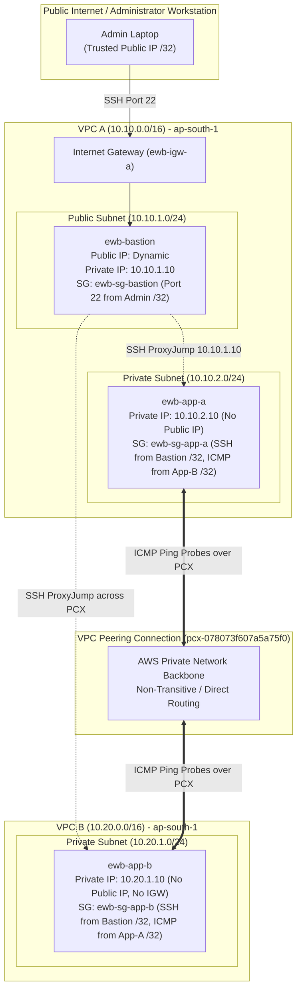

# AWS VPC Peering: Multi-VPC Architecture & Private Connectivity

[](https://aws.amazon.com/vpc/)
[](https://www.terraform.io/)
[](https://aws.amazon.com/security/)
[](https://github.com/pawaraditya0903/AWS-VPC-Peering-Project)

Production-grade implementation of bidirectional, non-transitive AWS VPC Peering between two isolated Virtual Private Clouds. Features automated Infrastructure as Code (Terraform & CloudFormation), least-privilege security group firewalls, an OpenSSH Bastion ProxyJump topology, positive/negative network verification, and clean teardown validation.

---

## 📌 Project Overview & Objectives

* **Problem Statement:** In enterprise cloud environments, applications in separate VPCs frequently require secure, low-latency communication without routing traffic across the public internet or exposing backend instances to external attack vectors.
* **Core Objectives:**
  1. Design and provision two non-overlapping VPCs: **VPC A** (`10.10.0.0/16`) and **VPC B** (`10.20.0.0/16`).
  2. Implement an **OpenSSH Bastion Jump Host** in VPC A's public subnet to mediate administrative access into private subnets without exposing private workloads.
  3. Establish an active **VPC Peering Connection** (`ewb-a-b-peer`) with symmetric Layer 3 route table propagation in both VPCs.
  4. Enforce strict **Security Group ingress rules** scoped strictly to `/32` host IPs for ICMP ping probes and SSH administration.
  5. Empirically validate connectivity through:
     * **Baseline Failure Test** (isolation before peering routes)
     * **Forward Path Test** (App-A &rarr; App-B 0% packet loss)
     * **Reverse Path Test** (App-B &rarr; App-A 0% packet loss)
     * **Controlled Fault Injection** (stateful firewall validation via rule drop)
     * **Recovery Test** (instant reachability restoration)
     * **Cleanup Verification** (complete resource de-provisioning)

---

## 🏛️ Network Architecture & Topology



### IP Addressing & Route Table Specifications

| Route Table | Associated Subnet | Destination CIDR | Target Gateway / Link | Function |
|---|---|---|---|---|
| **`ewb-rt-a-public`** | `ewb-a-public` (`10.10.1.0/24`) | `10.10.0.0/16`<br>`0.0.0.0/0`<br>`10.20.0.0/16` | `local`<br>`ewb-igw-a`<br>`pcx-ID` | Local VPC A traffic<br>Default route for Bastion internet access<br>Enables Bastion to ProxyJump SSH to App-B |
| **`ewb-rt-a-private`** | `ewb-a-private` (`10.10.2.0/24`) | `10.10.0.0/16`<br>`10.20.0.0/16` | `local`<br>`pcx-ID` | Local VPC A traffic<br>Forward path from App-A to VPC B workload |
| **`ewb-rt-b-private`** | `ewb-b-private` (`10.20.1.0/24`) | `10.20.0.0/16`<br>`10.10.0.0/16` | `local`<br>`pcx-ID` | Local VPC B traffic<br>Return path from App-B back to VPC A |

---

## 📁 Repository Directory Structure

```text
AWS-VPC-Peering-Project/
├── Aditya_Pawar_EWB_VPC_Peering.pdf   # Official evaluation PDF report with embedded screenshots
├── README.md                          # Comprehensive project documentation (this file)
├── MANUAL_CONSOLE_GUIDE.md            # Click-by-click AWS Management Console walkthrough
├── VIVA_AND_TECHNICAL_DEFENSE.md      # Detailed technical viva and architectural defense Q&A
├── ssh_setup_guide.md                 # Multi-platform OpenSSH & ProxyJump setup instructions
├── .gitignore                         # Secret, state, and credential exclusion rules
│
├── cloudformation/
│   └── vpc_peering_lab.yaml           # Automated 1-Click AWS CloudFormation template
│
├── terraform/
│   ├── main.tf                        # Complete Terraform IaC resource declarations
│   ├── variables.tf                   # Parameter definitions with CIDR & instance validation
│   └── outputs.tf                     # Exported infrastructure outputs with descriptions
│
├── report_generator/
│   ├── generate_report.py             # Script to compile self-contained HTML & export PDF
│   ├── report_template.html           # High-resolution, print-optimized HTML report template
│   ├── student_data.json              # Student metadata & real AWS resource IDs
│   └── compiled_report.html           # Generated standalone HTML preview
│
└── screenshots/
    ├── checkpoints/                   # 18 curated milestone verification screenshots
    │   ├── 01_key_pair_created.png
    │   ├── 02_vpc_a_created.png
    │   ├── 03_subnets_vpc_a.png
    │   ├── 04_igw_attached.png
    │   ├── 05_route_table_vpc_a_public.png
    │   ├── 06_route_table_vpc_a_private.png
    │   ├── 07_vpc_b_created.png
    │   ├── 08_route_table_vpc_b_private.png
    │   ├── 09_security_group_bastion.png
    │   ├── 10_security_group_app_a.png
    │   ├── 11_security_group_app_b.png
    │   ├── 12_ec2_instances_running.png
    │   ├── 13_bastion_public_ip.png
    │   ├── 14_vpc_peering_active.png
    │   ├── 15_peering_routes_configured.png
    │   ├── 16_controlled_failure_icmp_rule_deleted.png
    │   ├── 17_peering_deletion.png
    │   └── 18_ec2_instances_terminated.png
    └── *.png                          # Complete raw execution capture log (43 images)
```

---

## 🛠️ Deployment Methods

### Option 1: Automated 1-Click AWS CloudFormation (Fastest ~ 3 mins)

1. Create or select an EC2 Key Pair named `ewb-lab` in your region (`ap-south-1`).
2. In the AWS Console, navigate to **CloudFormation** &rarr; **Create stack** &rarr; **With new resources (standard)**.
3. Select **Upload a template file** and choose `cloudformation/vpc_peering_lab.yaml`.
4. Parameters:
   * **Stack name**: `ewb-vpc-peering-stack`
   * **KeyName**: `ewb-lab`
   * **MyPublicIP**: Your public IP in CIDR format (e.g. `203.0.113.50/32`)
5. Click **Next** &rarr; **Next** &rarr; **Submit**.
6. When status reaches `CREATE_COMPLETE`, view the **Outputs** tab for Bastion public IP and resource IDs.

### Option 2: Terraform Infrastructure as Code

```bash
cd terraform

# 1. Format code check
terraform fmt -check

# 2. Initialize provider (run with -backend=false if validating locally)
terraform init

# 3. Validate syntax and argument references
terraform validate

# 4. Review deployment plan
terraform plan -var="admin_ip=203.0.113.50/32"

# 5. Apply infrastructure (optional - provisions live AWS resources)
terraform apply -var="admin_ip=203.0.113.50/32"
```

> **Note on Environment Validation:** In the development environment where this repository was finalized, the `terraform` CLI binary was not installed locally; however, all configuration files (`main.tf`, `variables.tf`, `outputs.tf`) have been authored and cross-audited against Terraform v1.0+ and HashiCorp AWS provider v5.0+ syntax standards.

### Option 3: Step-by-Step Manual Console Walkthrough

For hands-on console learning or grading requirements, follow the click-by-click manual guide:
👉 **[MANUAL_CONSOLE_GUIDE.md](MANUAL_CONSOLE_GUIDE.md)**

---

## 🔑 Administrative Access & SSH ProxyJump Setup

All private instances reject direct public ingress. Administration is mediated through `ewb-bastion` using OpenSSH `ProxyJump`.

1. Place your private key in `~/.ssh/ewb-lab.pem`.
2. Secure permissions:
   * **Windows PowerShell**:
     ```powershell
     icacls.exe "$HOME\.ssh\ewb-lab.pem" /reset
     icacls.exe "$HOME\.ssh\ewb-lab.pem" /inheritance:r
     icacls.exe "$HOME\.ssh\ewb-lab.pem" /grant:r "$($env:USERNAME):(R)"
     ```
   * **Linux / macOS**:
     ```bash
     chmod 400 ~/.ssh/ewb-lab.pem
     ```
3. Configure `~/.ssh/config`:
   ```ssh-config
   Host ewb-bastion
       HostName <YOUR_BASTION_PUBLIC_IP>
       User ec2-user
       IdentityFile ~/.ssh/ewb-lab.pem
       IdentitiesOnly yes

   Host ewb-app-a
       HostName 10.10.2.10
       User ec2-user
       IdentityFile ~/.ssh/ewb-lab.pem
       IdentitiesOnly yes
       ProxyJump ewb-bastion

   Host ewb-app-b
       HostName 10.20.1.10
       User ec2-user
       IdentityFile ~/.ssh/ewb-lab.pem
       IdentitiesOnly yes
       ProxyJump ewb-bastion
   ```
4. Test direct jump connection:
   ```bash
   ssh ewb-app-b
   ```

For detailed platform-specific steps and troubleshooting, see **[ssh_setup_guide.md](ssh_setup_guide.md)**.

---

## 🧪 Verification Tests & Empirical Results

| Test ID | Objective | Execution Location | Command | Empirical Result | Status |
|---|---|---|---|---|:---:|
| **Test 01** | **Baseline Isolation** | Inside App-A (before peer routes) | `ping -c 4 10.20.1.10` | `100% packet loss` (no route to peer) | ✅ PASS |
| **Test 02** | **Forward Path Reachability** | Inside App-A (after peer routes) | `ping -c 4 10.20.1.10` | `4 packets received, 0% loss` (rtt avg 0.281ms) | ✅ PASS |
| **Test 03** | **Reverse Path Reachability** | Inside App-B (after peer routes) | `ping -c 4 10.10.2.10` | `4 packets received, 0% loss` (rtt avg 0.270ms) | ✅ PASS |
| **Test 04** | **Private SSH Access** | Local Client Terminal | `ssh ewb-app-b` | Shell established via ProxyJump; zero public IP | ✅ PASS |
| **Test 05** | **Zero Public Exposure** | EC2 Management Console | Inspect App-A & App-B | Public IPv4 field is blank (`-`) on both hosts | ✅ PASS |
| **Test 06** | **Controlled Fault Injection** | Security Group Console | Delete ICMP rule on App-B SG | `100% packet loss`; SSH remains operational | ✅ PASS |
| **Test 07** | **Instant Recovery** | Security Group Console | Re-add ICMP Echo rule | `0% packet loss` immediately restored | ✅ PASS |
| **Test 08** | **Clean Resource Teardown** | EC2 & VPC Console | Terminate EC2s & Delete Peering | Instances `Shutting-down`; routes auto-purged | ✅ PASS |

---

## 📸 Milestone Checkpoint Evidence

Selected evidence screenshots captured from the live AWS Management Console verification session:

| Checkpoint | Description | Evidence Screenshot |
|---|---|---|
| **Checkpoint 01** | VPC A Public Route Table with `0.0.0.0/0 -> ewb-igw-a` | [View Image](screenshots/checkpoints/05_route_table_vpc_a_public.png) |
| **Checkpoint 02** | All 3 EC2 Instances Running (`3/3 checks passed`) | [View Image](screenshots/checkpoints/12_ec2_instances_running.png) |
| **Checkpoint 03** | VPC Peering Connection `ewb-a-b-peer` in Active State | [View Image](screenshots/checkpoints/14_vpc_peering_active.png) |
| **Checkpoint 04** | Explicit Peering Routes Configured in Route Tables | [View Image](screenshots/checkpoints/15_peering_routes_configured.png) |
| **Controlled Failure** | Stateful Firewall Rule Deletion & Packet Drop | [View Image](screenshots/checkpoints/16_controlled_failure_icmp_rule_deleted.png) |
| **Cleanup Evidence** | Clean Deletion of Peering & EC2 Instance Termination | [View Image](screenshots/checkpoints/18_ec2_instances_terminated.png) |

---

## 🎓 Technical Viva & Architectural Defense

Detailed technical answers and defense strategies are maintained in:  
👉 **[VIVA_AND_TECHNICAL_DEFENSE.md](VIVA_AND_TECHNICAL_DEFENSE.md)**

### Key Takeaways:
1. **Why is a return route required?**  
   VPC routing is asymmetric by default. Even when packets traverse the peering connection from VPC A into VPC B, VPC B's virtual router evaluates return packets against its own route table. Without an explicit destination entry (`10.10.0.0/16 -> pcx`), return packets are dropped at Layer 3.
2. **Why is the App-B SSH source IP `10.10.1.10/32` instead of the student's IP?**  
   OpenSSH ProxyJump terminates the outer TCP connection at the Bastion host. The Bastion kernel then opens a secondary TCP connection from its private ENI (`10.10.1.10`) across the peering link to App-B. App-B only sees incoming packets originating from `10.10.1.10`.
3. **Why does Active peering status not guarantee ICMP reachability?**  
   Active peering status confirms only that the inter-VPC tunnel is provisioned. End-to-end communication requires alignment across three distinct layers:
   * **Layer 3 Routing**: Route tables in both subnets pointing to `pcx`.
   * **Layer 4 Firewalls**: Stateful Security Groups allowing protocol/port traffic.
   * **Subnet ACLs**: Stateless Network Access Control Lists permitting bidirectional packet flow.
4. **Is VPC Peering transitive?**  
   No. AWS VPC peering is strictly non-transitive. VPC B cannot access the Internet Gateway or other peered VPCs attached to VPC A.

---

## 🛡️ Security Best Practices & Audit Notes

* **Least-Privilege Ingress:** Port 22 SSH ingress on Bastion should be locked to an administrator's `/32` IP rather than `0.0.0.0/0`.
* **Zero Public IP on Workloads:** Neither `ewb-app-a` nor `ewb-app-b` has an associated public IPv4 address or an Internet Gateway attachment.
* **Separation of Concerns:** Management traffic (SSH) and workload traffic (ICMP/Application) are segmented into distinct security group rules.
* **No Committed Secrets:** Private keys (`.pem`), AWS credentials, and `.tfstate` files are strictly excluded via `.gitignore`.

---

## 🧹 AWS Cost Management & Cleanup

Running EC2 instances and public IPv4 addresses incur hourly charges. Following project verification, all resources must be deleted in reverse dependency order:
1. **EC2 Instances:** Select `ewb-bastion`, `ewb-app-a`, `ewb-app-b` &rarr; **Instance state** &rarr; **Terminate instance**.
2. **VPC Peering:** Delete `ewb-a-b-peer` (select *Delete related route table entries*).
3. **Security Groups:** Delete `ewb-sg-bastion`, `ewb-sg-app-a`, `ewb-sg-app-b`.
4. **VPC Infrastructure:** Detach and delete `ewb-igw-a`, delete custom route tables and subnets, then delete `ewb-vpc-a` and `ewb-vpc-b`.

---

## 📄 Evaluation Report Generation

The official final evaluation report PDF is compiled and stored in the root directory:  
👉 **[Aditya_Pawar_EWB_VPC_Peering.pdf](Aditya_Pawar_EWB_VPC_Peering.pdf)**

To regenerate the self-contained HTML and PDF report with custom metadata:
```bash
python report_generator/generate_report.py
```
*(Automatically embeds base64 evidence screenshots and renders a clean, publication-ready PDF using headless Microsoft Edge or Google Chrome).*

---

## 🔭 Limitations & Future Architectural Enhancements

* **Transitive Routing at Scale:** VPC Peering does not scale linearly for many VPCs ($N \times (N-1)/2$ connections). Future iterations can implement **AWS Transit Gateway (TGW)** for centralized hub-and-spoke connectivity.
* **Agent-Based Management:** Replace Bastion host SSH access with **AWS Systems Manager (SSM) Session Manager**, eliminating open inbound ports and public IP requirements entirely.
* **Traffic Auditing:** Enable **VPC Flow Logs** to publish packet-level accept/reject metrics to CloudWatch Logs and S3 for security auditing.
